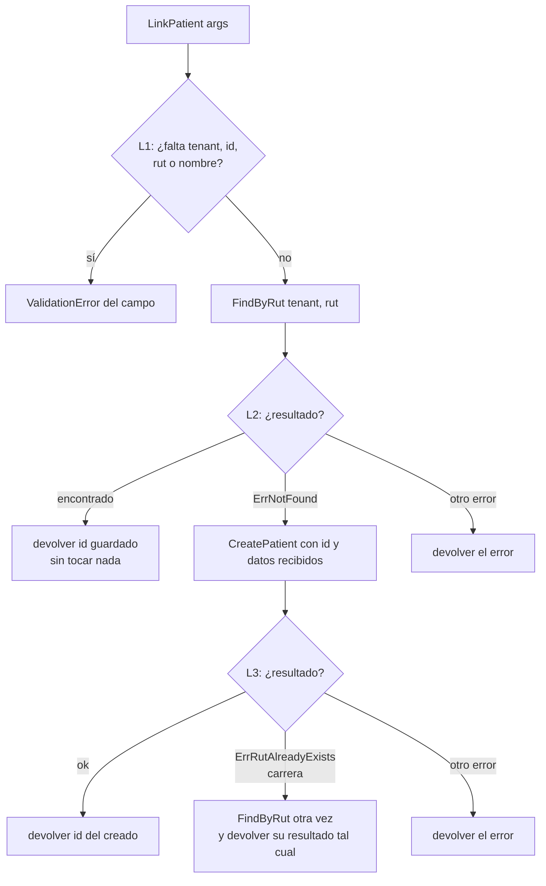

# `link_patient` — vincular o registrar sin exponer datos

Cada rombo lleva un id; [`docs/PLAN.md`](../PLAN.md) §4 asigna a cada rama su prueba.

Respuesta de la op: **siempre** `{"id": "..."}` y nada más, sea nuevo o existente.
