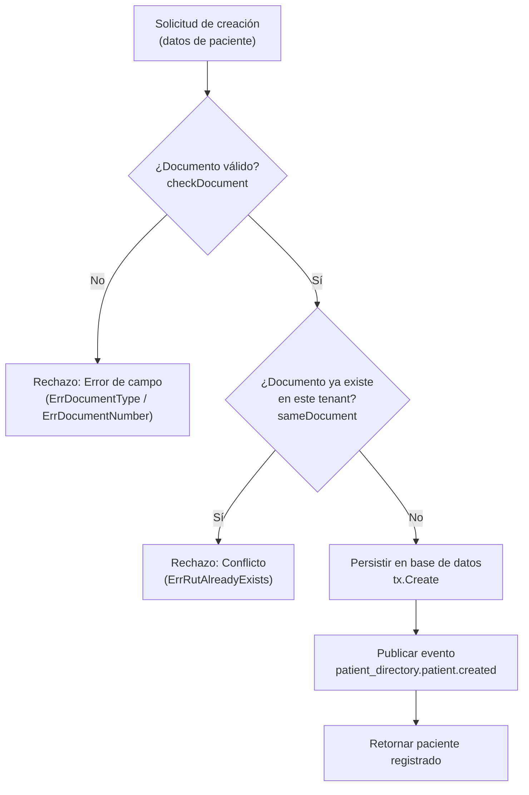

# Flujo de Registro de Pacientes

Este diagrama muestra el flujo de creación de un paciente (`patient_directory.patient.create` o `CreatePatient`), validando el documento de identidad y aplicando unicidad dentro del tenant. Se activa cuando un usuario o módulo registra un nuevo paciente, y se verifica en `tests/crud_test.go` (`TestCreate_DuplicateDocumentRejected` y `TestCreate_RetryIsIdempotent`).

## Recorrido paso a paso

1. **Recepción de la solicitud:** El cliente o módulo consumidor envía los datos del paciente para registrarlo en el tenant activo.
2. **Validación del documento:** `checkDocument` normaliza el RUT chileno o valida el formato y número de pasaporte o cédula extranjera. Si el formato es erróneo, se retorna inmediatamente un error de validación.
3. **Verificación de unicidad:** `sameDocument` consulta la base de datos dentro del tenant actual. Si ya existe un paciente distinto con el mismo documento y país, la operación falla con `ErrRutAlreadyExists`.
4. **Persistencia atómica:** Si las reglas pasan, [`webtyp.com/crud`](https://github.com/webtyp/crud) inserta el registro asignando los identificadores y marcas de tiempo del servidor.
5. **Notificación:** Una vez confirmada la transacción, se emite el evento `patient_directory.patient.created` al bus de eventos.
